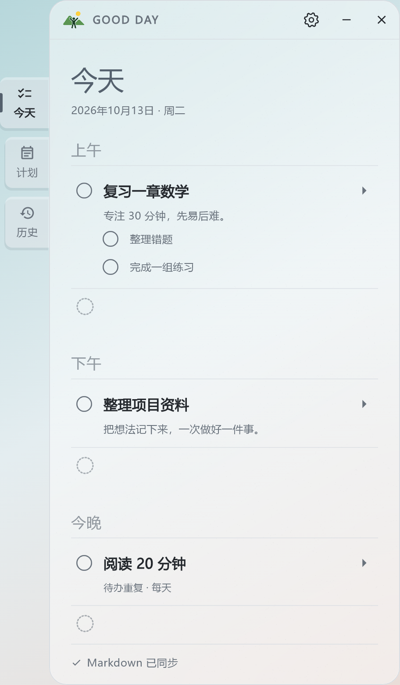
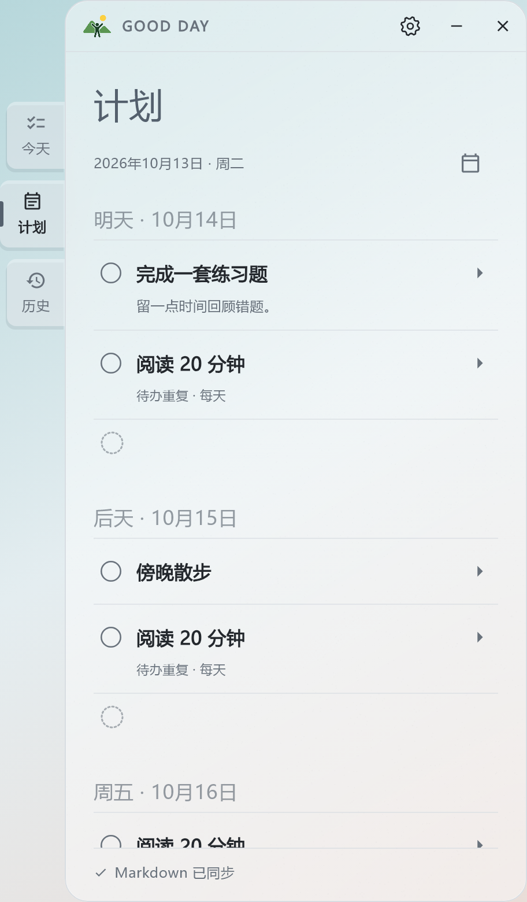
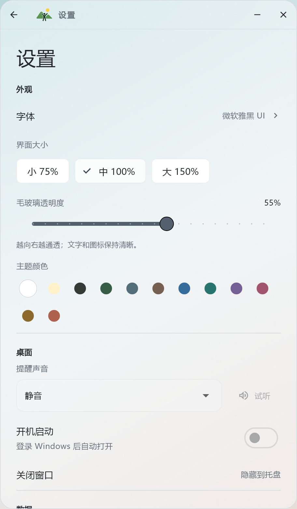

<p align="center">
  
</p>

<h1 align="center">Good Day</h1>

<p align="center"><strong>简约、清爽的 Windows 待办工具。</strong><br>把今天安排好，让接下来的日子更清晰。</p>

<p align="center">今天 · 计划 · 历史<br>毛玻璃外观 · Markdown 本地保存</p>

<p align="center">
  
</p>

<p align="center"><em>留白充足，层次清晰。把注意力留给要做的事情。</em></p>

## 下载即用

**[下载安装版](https://github.com/MonkeyStar7/Good_Day/releases/latest)** · [下载免安装版](https://github.com/MonkeyStar7/Good_Day/releases/latest) · [浏览源代码](https://github.com/MonkeyStar7/Good_Day)

适用于 **Windows 10／11 64 位**，无需安装开发环境。在最新发布页选择：

| 下载文件 | 适合你，如果…… |
| --- | --- |
| `Good-Day-…-windows-x64-setup.exe` | 希望点击安装，创建快捷方式，并在软件内检查更新。 |
| `Good-Day-…-windows-x64.zip` | 希望解压即用，自己管理程序文件夹。 |

两个下载包都附有 SHA-256 校验文件。

## 简单一点，也能安排得很好

| 特点 | 你可以这样用 |
| --- | --- |
| **清晰安排一天** | 上午学习、下午工作、今晚阅读。用备注记录想法，用子任务拆开大事。 |
| **习惯每天延续** | 设置每天、工作日或其他重复频率，每次独立记录完成情况；不开提醒也能重复。 |
| **数据留在本机** | 待办保存在自己的 Markdown 文件夹，支持备份、恢复和迁移数据位置。 |
| **清爽外观，自己调整** | 白色毛玻璃、多种主题色与字体，透明度和整体界面大小都可调。 |

## 看看它的样子

<table>
  <tr>
    <th align="center">计划：给接下来的日子留好位置</th>
    <th align="center">外观：调到自己看着舒服</th>
  </tr>
  <tr>
    <td align="center"><a href="docs/images/plans.png"></a></td>
    <td align="center"><a href="docs/images/settings.png"></a></td>
  </tr>
  <tr>
    <td>按日期安排事项，展开本月其他日期和后续月份。重复待办也会出现在对应日期。</td>
    <td>75%／100%／150% 整体缩放；透明度 0%～95% 可调，默认 55%。</td>
  </tr>
</table>

截图使用当前软件界面和示例数据；为保持文字清晰，以渐变背景导出。实际毛玻璃效果会随桌面背景和系统环境变化。点击功能截图可查看大图。

## 三步开始

1. **安装或解压**：安装版只需选择一个 Good Day 主目录；免安装版解压后运行 `good_day.exe`。
2. **写下待办**：点击“上午／下午／今晚”或计划中的日期行添加。已有事项下面的虚线圆圈可继续添加，名称下方可填写备注和添加子任务。
3. **按需重复、提醒或完成**：开启“待办重复”养成习惯；打开“设置提醒”选择日期、时间与提前提醒。点击圆圈完成事项。

提醒默认静音，也可在“设置 → 桌面 → 提醒声音”选择铃声。勾选主任务会同步完成全部子任务；已完成事项保持只读，可删除，或取消完成后再编辑。

## 还有这些实用功能

- **历史与垃圾桶**：查看、搜索已完成和未完成记录，恢复删除的事项。
- **桌面使用**：窗口置顶、开机启动、托盘后台运行，减少来回切换。
- **软件内更新**：安装版可在“设置 → 软件更新”检查、下载并安装 GitHub 正式新版。

<details>
<summary><strong>数据保存在哪里？升级和卸载会怎样？</strong></summary>

首次安装时，程序和数据分开放在同一个主目录里：

```text
Good Day/
├── App/   程序
└── MD/    待办、设置和备份
```

默认安装位置为当前用户的 `AppData\Local\Programs\Good Day`，也可自定义。免安装版首次使用时，默认数据位置为“文档”中的 `Good Day\MD`。需要更换数据位置时，可在设置中迁移。

升级沿用原安装目录和当前数据位置，保留待办、设置及备份；卸载保留数据目录。安装版可以在软件内下载更新，也可以从托盘退出后运行新版安装包。安装完成后如未自动打开，请使用桌面快捷方式。没有更新入口的旧版需要先手动安装一次新版。

</details>

<details>
<summary><strong>提醒如何运行？昨天没完成的任务会怎样？</strong></summary>

关闭窗口后，软件留在托盘继续提醒；彻底退出需在托盘右键选择“退出”。电脑关机或程序退出时无法弹窗，重新启动后会检查到期提醒；新设为过去时间的提醒仅标红。

未完成的过期事项保留在“已过期”和历史中。重复待办在每个日期独立记录完成情况，昨天未完成不影响今天出现新的待办。

</details>

<details>
<summary><strong>从源码构建</strong></summary>

准备 Flutter Windows 开发环境，然后运行：

```powershell
flutter pub get
flutter analyze
flutter test
flutter build windows --release
```

运行 `scripts/package-windows.ps1` 制作免安装包；安装 [Inno Setup 6](https://jrsoftware.org/isdl.php) 后，运行 `scripts/package-installer.ps1 -Compiler "安装目录\ISCC.exe"` 制作安装包。

截图导出方法见 [截图说明](docs/images/README.md)。

</details>
